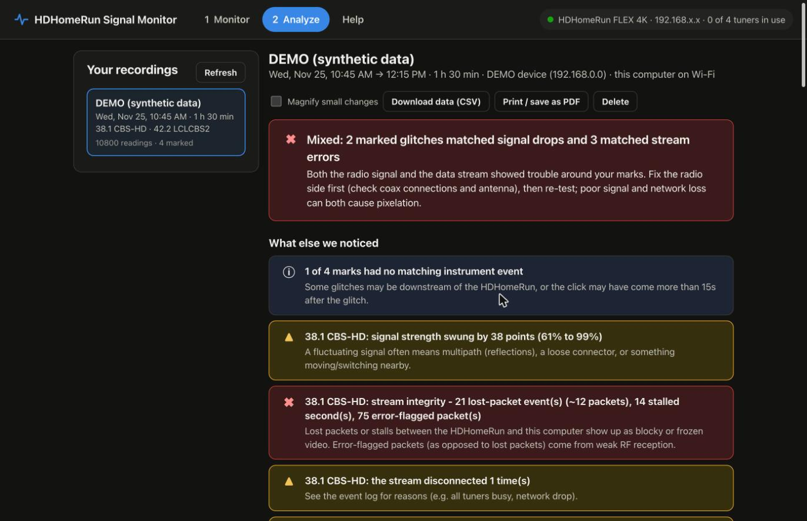
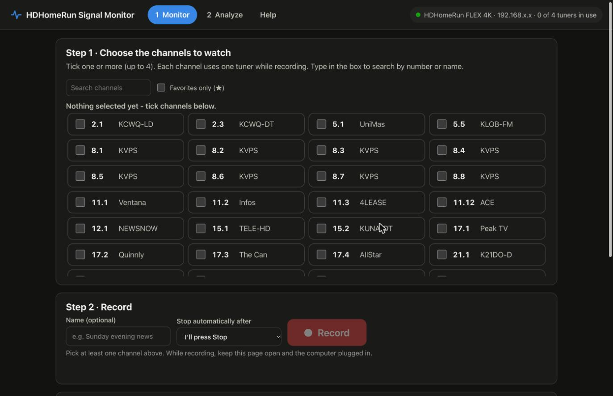
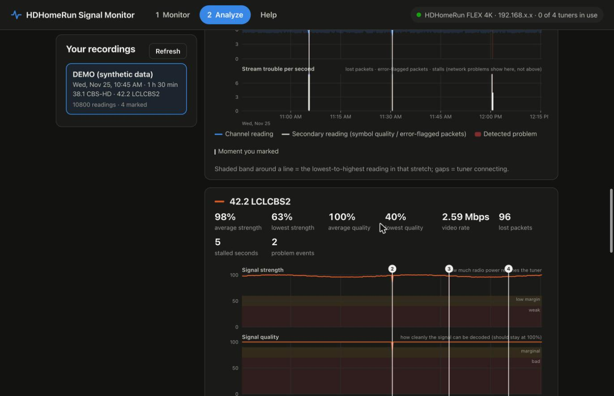

# HDHomeRun Signal Monitor

A small, local web app that answers one question: **when my over-the-air TV pixelates, is it the antenna, the network, or something downstream?**

It watches an [HDHomeRun](https://www.silicondust.com/) tuner while you watch TV. You press a button each time the picture breaks up, and it graphs signal strength, signal quality, video data rate and lost packets around each of those moments, then gives a plain-English verdict.

- Pure Python 3 standard library on the backend, plain HTML/JS/SVG on the front. **No pip, no npm, no internet needed.**
- Runs on your own computer, binds to `127.0.0.1` only. Nothing is uploaded anywhere.
- Built to be handed to a non-technical person: step-by-step install guide in [`INSTALL.txt`](INSTALL.txt), written for a Mac with a brand-new Terminal.



## Features

- Auto-discovers the HDHomeRun on your LAN (UDP broadcast, with `hdhomerun.local` fallback), or type an IP.
- Pick up to 4 channels (one per tuner) and monitor them simultaneously.
- **Record / Stop** with optional auto-stop. The Mac is kept awake while recording (`caffeinate`).
- **Mark glitch** buttons (pixelated / froze / sound dropped), also bound to the space bar.
- Two independent measurements per channel, each second:
  - **RF side** from the device: signal strength, signal quality, symbol quality.
  - **Network side** measured by this program: it pulls the MPEG-TS stream and counts continuity-counter errors (lost packets), error-flagged packets and stalls.
- **Analyze:** rule-based verdict (RF dip, stream loss, both, or "nothing wrong here, so look downstream"), cross-channel common-cause check, Wi-Fi vs Ethernet note, detailed zoomable charts, event table, CSV export and a landscape print/PDF layout.
- Hand-built SVG charts: min/max envelopes, status zones, crosshair tooltips, drag to zoom.




The screenshots use the bundled **synthetic** demo recording (`python3 tools/make_demo_session.py`), not real measurements.

## Quick start (macOS, Linux)

Needs Python 3.8 or newer (macOS: `xcode-select --install` provides it) and a computer on the same network as the HDHomeRun.

```sh
git clone <this repo> hdhr-monitor
cd hdhr-monitor
./start.sh            # opens http://localhost:8787
```

Options: `--device 192.168.1.50` (skip discovery), `--port 8800`. On macOS, allow the **Local Network** permission for Terminal when prompted.

Step-by-step guide for a first-time user: [`INSTALL.txt`](INSTALL.txt).

Want to try the Analyze page without a tuner? Run `python3 tools/make_demo_session.py`, restart, and open the DEMO recording.

## How to read the verdict

| What you see | What it means |
|---|---|
| Signal strength or quality dips around your marks | RF problem: antenna, coax, connectors, interference, multipath |
| Lost packets or stalls, signal fine | Network problem between the HDHomeRun and this computer (Wi-Fi, powerline, switch) |
| Both | Fix RF first, then re-test |
| Nothing wrong at the marked moments | The tuner and network were fine, so the cause is downstream (TV, DVR, player) |

## How it works

`server.py` is a single-file `ThreadingHTTPServer`. It uses the HDHomeRun's local HTTP API (`discover.json`, `lineup.json?show=all`, `status.json`) for RF readings and opens one stream per channel (`http://<ip>:5004/auto/v<ch>`) to parse the transport stream itself. Each recording is stored under `data/sessions/<id>/` as `samples.csv` (one row per channel per second), `events.jsonl` and `meta.json`. About 0.25 MB per channel-hour.

The first 4 seconds after a tuner locks are ignored (readings settle during lock-on), and a dropped stream is counted as a stream event, not hidden.

## Security notes

- Binds to localhost only; checks `Host`/`Origin` headers against DNS rebinding and CSRF; guards against path traversal.
- The device's `DeviceAuth` value (in `discover.json`) is never stored or forwarded.
- Recordings stay on disk in `data/` (git-ignored).

## Limitations

- Measures *antenna → HDHomeRun → this computer*. It cannot see what happens inside a TV or DVR.
- Primarily tested on macOS with Python 3.9 and Chrome. Safari should work but has had less testing; the printed landscape layout may be ignored by Safari.
- HDHomeRun only. Other tuner boxes are not supported (yet).

## License

MIT, see [LICENSE](LICENSE).
